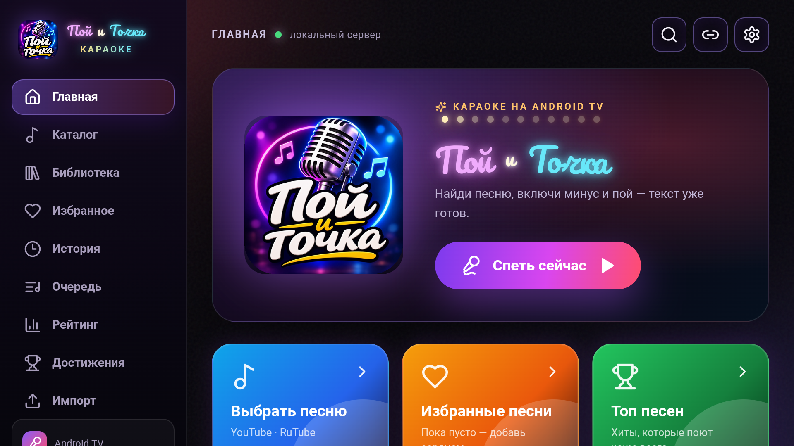
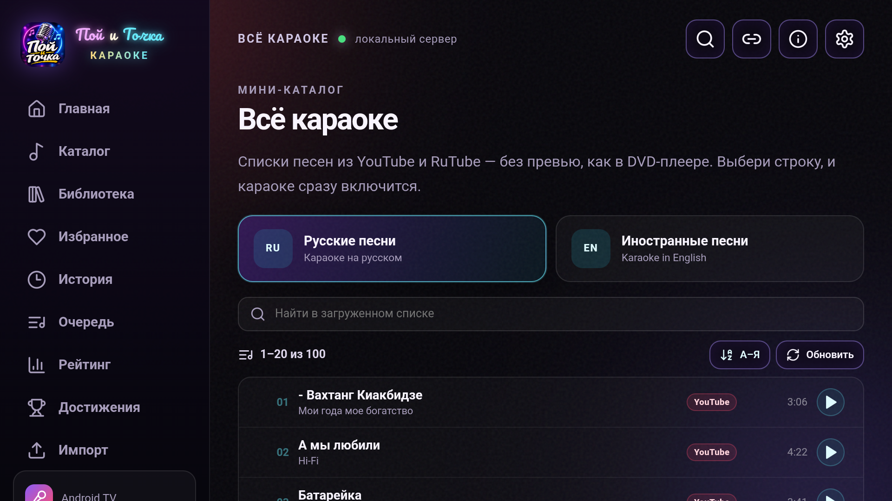

# Пой и Точка — караоке для Android TV и телефона

Автономное караоке-приложение для Android. Внутри APK работают локальный сервер,
поиск YouTube/RuTube, тексты LRCLIB, локальная библиотека и офлайн-пакеты.
Отдельный компьютер и веб-версия не нужны.





## Возможности

- Поиск караоке в YouTube и RuTube, результаты появляются по мере готовности источников.
- «Всё караоке» — простой список без превью: русские и иностранные песни, запуск по строке.
- Список разбит на страницы по 20 песен; сортировка по алфавиту А–Я или Я–А.
- Кнопка «Загрузить ещё» добавляет следующую сотню песен, до пяти наборов.
- Есть поиск по загруженному списку и кнопка «Искать везде» для остального YouTube/RuTube.
- У каждой песни показан источник: YouTube или RuTube.
- Если синхронного текста нет, приложение автоматически переключается на видео.
- Тексты LRCLIB с подсветкой по времени; просмотренные тексты кэшируются на устройстве.
- Режимы «С видео» и «Только текст»; во втором видео скрыто, а текст занимает основной экран.
- Компактный плеер, очередь песен, избранное, история, рейтинг и достижения.
- Скорость песни и тональность для RuTube HLS.
- Локальная библиотека: 50 встроенных песен-метаданных, импорт JSON-каталога и ZIP-пакетов.
- ZIP-пакеты с аудио и LRC: импорт с устройства или по прямой ссылке, удаление из библиотеки.
- Открытие YouTube, RuTube и VK Видео по ссылке.
- Нативный YouTube TV-плеер на телевизоре и IFrame Player API на телефоне.
- RuTube HLS в текстовом режиме через Media3 ExoPlayer.
- Встроенный AmneziaWG VPN: туннель поднимается в фоне, LAN не заворачивается.
- Один APK для Android TV и телефона: на телефоне включается портретная раскладка.
- Раздельные arm64/arm32 APK и R8: около 13–14 МБ.

## Формат офлайн-пакета

```text
pack.zip
  catalog.json
  audio/song.mp3
  lyrics/song.lrc
```

`catalog.json`:

```json
{
  "name": "Мой пакет",
  "tracks": [
    {
      "title": "Название",
      "artist": "Исполнитель",
      "genre": "Русский рок",
      "audio": "audio/song.mp3",
      "lyrics": "lyrics/song.lrc",
      "duration": 218
    }
  ]
}
```

Пакет импортируется в разделе «Библиотека» кнопкой «Импорт ZIP-пакета» или
скачивается по ссылке http/https.

## Структура

```text
karaoke/
  web/                 React + TypeScript UI
  android/             Kotlin, WebView, локальный сервер, VPN
  screenshots/         скриншоты интерфейса
  dist/                готовые APK (не коммитятся)
```

## Архитектура

```text
Android APK
  ├─ AmneziaWG VpnService
  ├─ локальный HTTP-сервер 127.0.0.1:8787
  │    ├─ UI из assets/web
  │    ├─ NewPipeExtractor (YouTube)
  │    ├─ RuTube API + HLS
  │    ├─ LRCLIB
  │    └─ локальные пакеты и медиа
  └─ WebView с интерфейсом
```

## Сборка

Нужны Node.js/pnpm, JDK 21, Android SDK 35 и build-tools 35.0.0.

UI:

```powershell
cd web
pnpm install
pnpm build
```

Android:

```powershell
cd android
./gradlew assembleDebug
```

Сборка копирует `web/dist` в `assets/web`. Release-сборка использует
`android/debug.keystore`; для локальной сборки создайте его:

```powershell
keytool -genkeypair -v -keystore android/debug.keystore `
  -storepass android -alias androiddebugkey -keypass android `
  -dname "CN=Android Debug,O=Android,C=US" -keyalg RSA -keysize 2048 -validity 10000
```

APK:

- `app/build/outputs/apk/release/app-arm64-v8a-release.apk` — телефон;
- `app/build/outputs/apk/release/app-armeabi-v7a-release.apk` — TV.

Публичные APK в GitHub Releases собраны **без VPN-конфигов**: импортируйте свой
`.conf` на экране настройки VPN. Локальные APK для личного телевизора могут содержать
конфиг, но он не попадает в репозиторий. Публичные APK подписаны debug-ключом и
предназначены для личной установки; для Google Play нужен отдельный release-ключ.

## Ограничения и правовая информация

- Приложение не содержит и не распространяет музыкальные произведения.
- YouTube/RuTube/VK — сторонние сервисы; права на музыку и тексты принадлежат правообладателям.
- Прямое извлечение аудио YouTube/RuTube в текстовом режиме не является официальным API
  и может перестать работать при изменении сервисов.
- VK Видео по ссылке работает только для публичных роликов без входа в аккаунт.
- Пользовательские ZIP-пакеты добавляет сам пользователь; ответственность за их содержимое
  лежит на нём.
- VPN-конфиги и ключи не входят в репозиторий.
- Проект не даёт лицензии на музыку, тексты или товарные знаки third-party.

## Статус

Версия 0.2.0, build 2. Android TV и телефон, локальные пакеты, ссылки, Media3 HLS,
AmneziaWG и экран «О приложении».
